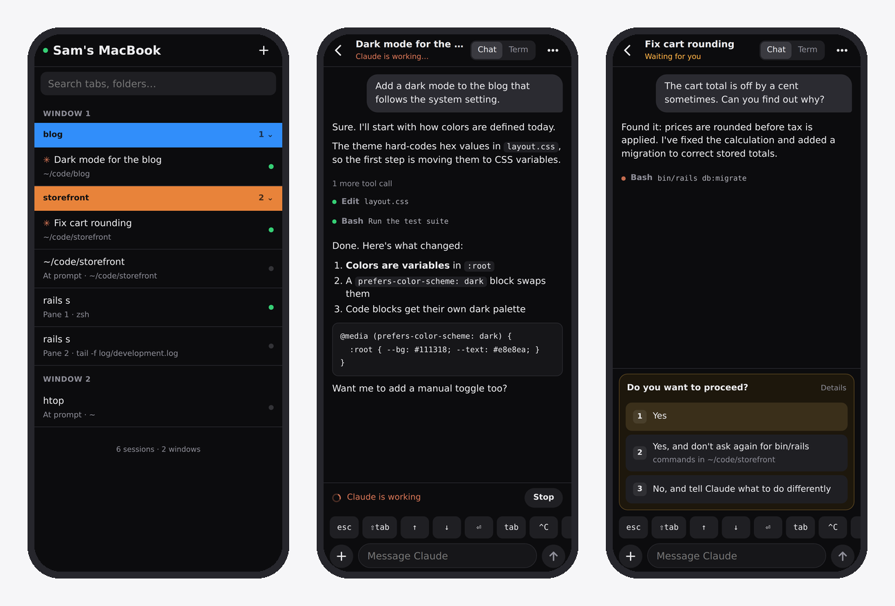
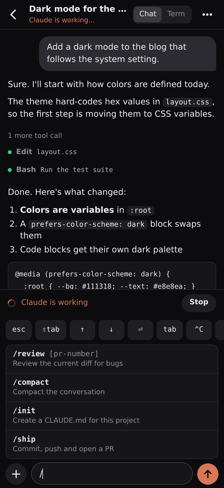
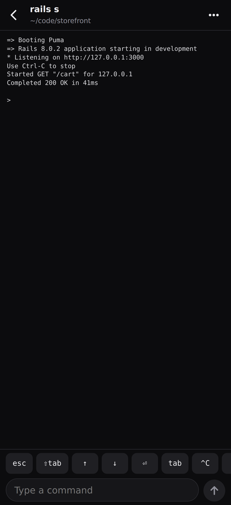
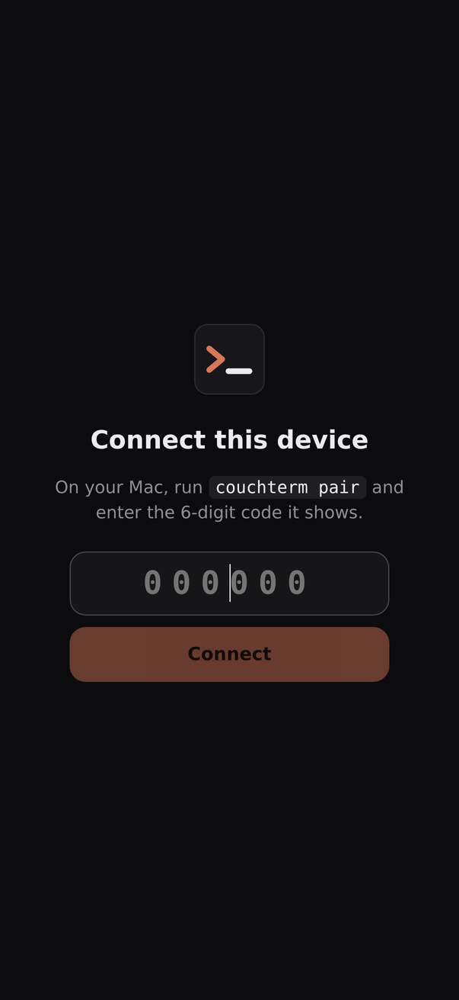

# iterm-web

**Your iTerm2 tabs and Claude Code sessions, on your phone.**

iterm-web is a small server for your Mac and a phone web app to go with it. Open it from anywhere on your [Tailscale](https://tailscale.com) network to see every iTerm2 window, tab and split pane. Tap into a Claude Code session and you get a real chat view instead of a squashed terminal: messages render as text, tool calls are one line each, permission prompts become buttons, and there's a composer built for thumbs.



## Why

Running Claude Code on your Mac and checking in from your phone is a great way to work, until you try to use a terminal on a phone. TUIs don't fit, the on-screen keyboard covers half the screen, and answering "Do you want to proceed?" means aiming for arrow keys.

iterm-web reads the conversation from Claude Code's own transcript and shows it the way a chat app would. Your messages and taps still go to the real terminal, so nothing about how you run Claude changes.

## Features

- **Every tab, organized like iTerm.** Windows, colored tab groups and split panes, in iTerm's order. Search, swipe left to close. ✳ marks tabs running Claude.
- **Claude as a chat.** Rendered Markdown, compact tool calls you can tap to expand, and long runs of tool calls collapsed. It updates live as Claude works.
- **Prompts as buttons.** Permission requests, plan approvals and questions from Claude become big tappable options, with each option's description.
- **A composer built for phones.** It grows as you type, offers `/` suggestions from your skills and commands, attaches photos and files (Claude gets their paths on your Mac), and keeps a draft per tab.
- **Switch tabs with a swipe.** Swipe right in any session (or tap its title) to pull in your tab list, then tap another tab to jump to it.
- **The keys you actually need.** While chatting, a slim bar shows Claude's current mode (tap to cycle, like ⇧tab) and esc. Arrows and ⏎ appear automatically when Claude shows a menu that needs them, and "keys" reveals the rest. The terminal view has the full set: esc, ⇧tab, arrows, ⏎, tab, ^C and ^D. A **Stop** button appears while Claude is working.
- **Any terminal, too.** For tabs not running Claude, a terminal view shows the screen, with a command box and the same keys.
- **Fast.** One persistent connection to iTerm, and live updates pushed over a WebSocket the moment the screen or transcript changes.
- **Installs like an app.** Add it to your home screen and it opens full screen.

| | | |
|---|---|---|
|  |  |  |

## Requirements

- macOS with [iTerm2](https://iterm2.com)
- [Node.js](https://nodejs.org) 20.12 or newer
- [Tailscale](https://tailscale.com/download/mac) on the Mac and on your phone, signed in to the same tailnet
- Optional but recommended: iTerm2's Python API, which makes everything faster. Turn it on in **iTerm2 → Settings → General → Magic → Enable Python API**.

## Install

On your Mac:

```sh
npm install -g iterm-web
iterm-web setup
```

`setup` checks the requirements, then:

1. installs a login agent so iterm-web runs in the background and starts when you log in;
2. publishes it to your tailnet with `tailscale serve` on port 9443 (change it with `--https-port`);
3. shows a QR code and a 6-digit pairing code.

Scan the QR code with your phone (it must be on your tailnet), or open the URL and type the code. Then use **Share → Add to Home Screen**. If the home-screen app asks to connect again, run `iterm-web pair` for a fresh code. To add another device later, run `iterm-web pair` too.

The first time iterm-web controls iTerm2, macOS asks whether to allow it. Click **OK**. If you missed the prompt, enable it under **System Settings → Privacy & Security → Automation**, then run `iterm-web restart`.

### Commands

```text
iterm-web setup       Check requirements, install the login agent, publish it on your tailnet
iterm-web pair        Connect another phone or tablet (--reset signs out every device)
iterm-web doctor      Check requirements without changing anything
iterm-web status      Is it running, and where?
iterm-web restart     Restart the background server (e.g. after upgrading)
iterm-web logs        Recent log output
iterm-web uninstall   Remove the login agent and stop serving it on the tailnet
iterm-web start --demo   Try the UI with made-up sessions at http://127.0.0.1:47823
```

To upgrade: `npm install -g iterm-web@latest && iterm-web restart`.

## Security

iterm-web can type into your terminals, so it is effectively a remote shell. It's designed so that only you can reach it:

- **Loopback only.** The server listens on `127.0.0.1`. Other devices can reach it only through `tailscale serve`, which is limited to your tailnet.
- **Your Tailscale login, checked on every request.** Tailscale Serve tells iterm-web who is connecting. Only the logins listed in `~/.iterm-web/config.json` are accepted; `setup` adds yours. Tagged devices and people you've shared the Mac with are refused.
- **Paired devices only.** Each device pairs once with a 6-digit code from `iterm-web pair`. Codes expire after 10 minutes and allow 5 tries. Pairing gives the device a secret, which it sends with every request. Only you can read the copy on the Mac, so other accounts and sandboxed apps on the Mac can't use iterm-web either. `iterm-web pair --reset` signs out every device.
- **Never on the public internet.** iterm-web refuses requests that arrive through [Tailscale Funnel](https://tailscale.com/kb/1223/funnel), and `setup` and `status` warn if Funnel is on for its port. Don't turn Funnel on for it.
- **Safe from other websites.** Cross-site requests can't carry the device secret. iterm-web also checks the `Host` header (which defeats DNS rebinding), refuses to load inside frames, and uses a strict content security policy, so images in Claude's output show as links instead of loading.
- **Little is stored.** The Mac reads terminal text and transcripts on demand and never logs them. Your phone keeps the last few screens it showed you so they open instantly. Attachments you send are kept in `~/.iterm-web/attachments` for 7 days so Claude can read them.

Like any tool that runs as you, iterm-web can't protect you from malware that already runs as your user on the Mac.

Found a problem? See [SECURITY.md](SECURITY.md).

## How it works

```text
phone ──HTTPS (tailnet)──► tailscale serve ──► iterm-web (127.0.0.1:47823) ──► iTerm2
                                                    │                         ├─ Python API socket (fast path)
                                                    │                         └─ AppleScript (fallback, tab management)
                                                    └─► ~/.claude transcripts (read only)
```

- **Tabs and screens** come from iTerm2's local API over one persistent connection. If the Python API is off, iterm-web falls back to AppleScript.
- **Claude conversations:** iterm-web finds the Claude Code process in the tab's foreground, matches it to its session record, and reads that session's JSONL transcript. It never guesses based on folder or recency. If there's no transcript, you get the terminal view.
- **Prompts and the "working" state** are recognized from the screen: Claude's numbered menus and its "esc to interrupt" status line.
- **Sending a message** types it into the terminal as a single bracketed paste followed by Enter, exactly as if you'd pasted it.

## Limitations

- **macOS and iTerm2 only.** Other terminals have no comparable automation interface.
- **The terminal view is text, not an emulator.** You see the screen and recent scrollback without colors, and full-screen apps like `vim` or `htop` are view-only in practice.
- **Prompt buttons and the working indicator read Claude Code's screen.** A Claude Code update that changes those screens can break them until iterm-web catches up. The chat itself comes from the transcript and is more stable. Please [open an issue](https://github.com/bborn/iterm-web/issues) when something looks off.
- **Voice input** is your phone keyboard's dictation button.

## FAQ

**How is this different from iTerm2 Buddy?** Buddy streams video of the terminal to an iOS app. iterm-web is a web app that understands Claude Code, so it can show conversations as chat and prompts as buttons. It also works on any phone browser.

**What about Claude Code's own remote access?** If you start sessions that way, use it. iterm-web is for the iTerm2 tabs you already have open, and for everything in them that isn't Claude.

**Does it work without Claude Code?** Yes. Every tab gets the terminal view, the command box and the keys.

**Android?** Yes, any modern mobile browser works.

**Why Tailscale and not a password?** Tailscale already gives each of your devices a private, authenticated connection to your Mac. iterm-web reuses that instead of inventing a login, and never needs to be reachable from the internet.

## Develop

```sh
git clone https://github.com/bborn/iterm-web && cd iterm-web
npm install
npm run dev        # demo data on :47823, Vite with hot reload on :5173; works on any OS
npm test
npm run typecheck
npm run build      # dist/web (the app) and dist/cli.js (server + CLI)
```

The demo backend (`server/fake.ts`) serves made-up sessions, so you can work on the UI without touching real terminals.

**Layout:**
- `server/cli.ts`: the `iterm-web` command. `setup.ts` handles the checks, launchd and Tailscale.
- `server/index.ts`: HTTP and WebSocket server. `auth.ts` checks identity.
- `server/iterm.ts`, `iterm-api.ts`, `bridge.ts`: iTerm2 through the Python API socket and AppleScript.
- `server/claude-*.ts`: find the running Claude Code session and read its transcript; prompt detection.
- `server/live.ts`: per-session live updates (screen notifications, transcript watching, adaptive polling).
- `web/`: the React app.

Pull requests are welcome. For anything bigger than a fix, please open an issue first.

## License

[MIT](LICENSE) © Bruno Bornsztein

iterm-web is an independent project, not affiliated with or endorsed by iTerm2 or Anthropic. iTerm2 is by George Nachman; Claude and Claude Code are Anthropic's.
